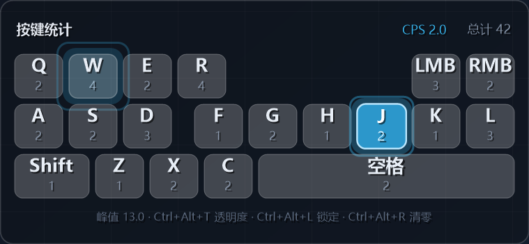

# 桌面键盘 · 悬浮按键计数器

仿「键显 / keystrokes」模组的 Windows 小工具：一个**半透明**悬浮条，实时显示 **W A S D、Q E R Z X C、鼠标左/右键、空格、Shift、F G H J K L** 每个键按了多少次（共 20 个键），同时显示总次数、实时 CPS（每秒按键数）和峰值。

窗口按像素透明（不只是整体半透明）：面板是磨砂玻璃感的深色层，按键、数字和文字保持清晰，游戏画面从面板里透出来看得很清楚。每个键帽上方是**大号键名**，下面一行**小字是按压次数**。



## 快速开始

1. 双击 `桌面键盘.exe`，不用安装。
2. 启动后默认「锁定」：置顶显示、鼠标点击穿透，不会挡住游戏里的点击。
3. 直接玩，格子会跟着按键亮起并累计次数；计数自动保存，下次打开接着算。

## 视觉与动画

- **按下**：键帽放大回弹、变成青色，后面泛起光晕，再向外扩散一圈细环；
- **计数**：数字颜色闪一下（亮青 → 常规灰）并轻微弹跳；
- **松开**：颜色平滑淡回常色；
- 底部提示文字淡入淡出并轻微上浮。

性能上只在有按键/动画时重绘面板，静止时几乎不占 CPU：面板空闲约 0.3% 单核，连续 50 次/秒狂敲约 12% 单核。

## 快捷键

| 快捷键 | 作用 |
| --- | --- |
| `Ctrl+Alt+T` | 循环面板不透明度：35% → 50% → 62% → 75% → 90% |
| `Ctrl+Alt+L` | 锁定 / 解锁悬浮窗 |
| `Ctrl+Alt+R` | 全部计数清零 |
| `Ctrl+Alt+Q` | 退出 |

解锁后可以：

- 按住**空白处**拖动窗口位置（松开自动保存位置）；
- **单击某个按键格子**，只把那个键清零；
- **右键**弹出菜单：锁定 / 解锁、切换不透明度、重置全部计数、重新居中、退出。

解锁时会自动把面板调到至少 80% 不透明，方便看清要点的格子；重新锁定后回到你设定的透明度。

## 配置文件

首次运行会在 exe 同目录生成 `桌面键盘.config.txt`，改完重启生效：

| 字段 | 含义 |
| --- | --- |
| `scale` | 界面缩放，0.5 ~ 3.0，默认 1 |
| `opacity` | 面板不透明度，0.2 ~ 1.0，默认 0.62（越低越透，能看到下面的画面） |
| `x` / `y` | 窗口位置（像素） |
| `locked` | 1 = 锁定（点击穿透），0 = 可拖动 |
| `stayontop` | 1 = 锁定状态下每 1.2 秒重新置顶（默认），0 = 只置顶一次 |
| `capture` | `auto`（默认，钩子优先）/ `hook`（只用键盘钩子）/ `raw`（只用 Raw Input） |
| `debug` | 1 = 把采集事件写进 `debug.log`，用于排查游戏里不计数 |
| `peak` | 历史最高 CPS |
| `count.*` | 各按键累计次数 |

删掉这个文件就恢复默认：位置在屏幕右上角，计数从 0 开始，透明度 62%。

**计数保存**：每次按键后最多 2 秒就会自动写盘，正常退出（Ctrl+Alt+Q / 右键退出）时也会立刻保存，所以直接关进程、强杀、蓝屏重启都不会丢太多（最多丢最后 2 秒）。启动时如果读到了旧计数，底部会提示「已恢复上次计数：总计 N」。

如果 exe 所在目录不可写（比如放在 Program Files），会自动把配置存到 `%LOCALAPPDATA%\桌面键盘\桌面键盘.config.txt`，下次启动优先读这里；两处都写不进去时底部会提示「计数保存失败」。

## 游戏里不计数？（无畏契约等）

这类游戏（尤其带 Vanguard 的）会做两件事，导致按键统计失效：

1. 游戏以高权限运行，普通权限的全局键盘钩子收不到发往它的按键；
2. 内核级反作弊会拦截未受信任进程的输入钩子。

程序内置了**两条采集通道**：

- **键盘钩子**（`WH_KEYBOARD_LL`）：普通窗口下最稳；
- **Raw Input**（`RIDEV_INPUTSINK`）：设备级读取，不经过钩子，游戏抢焦点时也能收到。

`capture=auto`（默认）下，钩子只要有事件就只用钩子，Raw Input 只在钩子连续 3 秒没有任何事件时才接管——两条通道有 20ms 去重，不会重复计数（实测 5 次按键计 5 次、3 次点击计 3 次）。

**排查步骤**：

1. 把 `桌面键盘.config.txt` 里的 `capture` 改成 `raw`，重启程序，进游戏试；
2. 再把 `debug` 改成 `1`，进游戏按几下，看程序目录的 `debug.log`：
   - 有 `rawkey vk=...` / `hook ...` 记录 → 事件收到了，是显示或渲染的问题；
   - 完全没有记录 → 被反作弊拦了，任何软件方案都读不到，只能换硬件/双机方案。

另外确认游戏是**无边框窗口**（独占全屏下覆盖层画不出来）；如果游戏以管理员运行，本程序也右键「以管理员身份运行」。
## 已知限制

- 想让它覆盖在游戏画面上，游戏需要用**窗口化**或**无边框窗口**模式；独占全屏时看不到悬浮窗（按键仍然会被统计）。
- 这类工具靠全局键盘/鼠标钩子读取输入，个别反作弊（EAC、BattlEye、Vanguard 等）可能拦截或误判；它只读事件，不注入、不修改游戏。
- 如果游戏以管理员身份运行，建议本程序也右键「以管理员身份运行」，否则管理员进程里的按键可能统计不到。
- 只统计上面列出的 20 个键，其它按键不计入总次数。

## 重新编译

不依赖 .NET SDK，用 Windows 自带的 .NET Framework 编译器即可：

```powershell
powershell -ExecutionPolicy Bypass -File build.ps1
```

| 文件 | 说明 |
| --- | --- |
| `src/KeyStats.cs` | 全部源码（WinForms + `WH_KEYBOARD_LL` / `WH_MOUSE_LL` 全局钩子 + `UpdateLayeredWindow` 逐像素透明） |
| `src/make_icon.py` | 生成 `桌面键盘.ico`（需要 Pillow） |
| `build.ps1` | 编译脚本 |
| `桌面键盘.exe` | 编译产物 |
| `预览.png` | 界面截图 |


## 想改键位 / 布局 / 颜色？

在 `src/KeyStats.cs` 里：

- `CreateCells()`：增删要统计的按键（`Vk` 是 Windows 虚拟键码，鼠标键用 `MouseButton` 1/2）；
- `BuildLayout()`：每个格子的位置和大小；
- `DrawCell()`：配色与动画时长（160ms 回弹、430ms 扩散圈、220ms 数字弹跳），以及键名/次数的字号与位置；
- `CreateFonts()`：`_bigFont` 是键名、`_smallFont` 是次数，想再调大小改这里；
- `_opacity` 默认值、`CycleOpacity()` 里的档位。

改完跑一次 `build.ps1` 即可。
